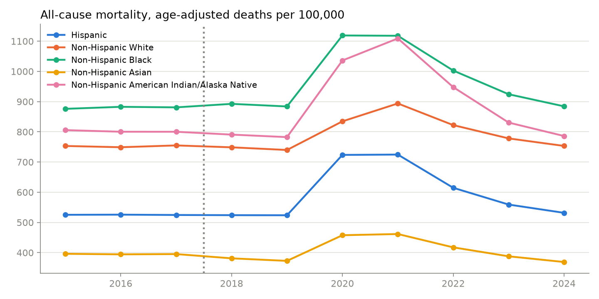

# US Health Equity

<a target="_blank" href="https://cookiecutter-data-science.drivendata.org/">
    
</a>

How have US vaccination rates (MMR and flu) and mortality from major diseases changed since
2015, how do they differ by **race/ethnicity, household income and college attainment**, and
**has healthcare spending increased**? The project pulls public data from CDC, CMS, the Census
Bureau and BLS, builds analysis tables, fits simple statistical models and presents everything
in an interactive **Streamlit dashboard**.



## Quick start

```bash
python3.11 -m venv .venv && source .venv/bin/activate
make requirements      # install dependencies (+ this package in editable mode)
make pipeline          # download → clean → features → models → figures (~5 min)
make dashboard         # open http://localhost:8501
```

No API keys are needed. Raw downloads are cached in `data/raw/`; re-running is fast. Pass
`--force` to `python -m us_health_equity.dataset download` to refresh from source.

## Headline findings (data through 2024–2026, depending on source)

| Question | Finding |
|---|---|
| MMR | Kindergarten MMR coverage (US median) fell from **94.6% (2015-16) to 91.5% (2025-26)**; exemptions rose from 1.9% to 4.8%. 39 of 49 reporting states were below the 95% target in 2025-26. |
| MMR × income | Among young children, ≥1-dose MMR was **87.8%** under 133% of the poverty line vs **95.4%** above 400% (NIS-Child, 2016-19 cohorts). |
| Flu | Coverage for everyone 6 months+ peaked at ~52% in 2020-21 and was **43.8% in 2025-26**; non-Hispanic White coverage has been higher than Hispanic coverage in every season. |
| Flu × income/education | Among adults 65+, flu-shot coverage in 2025 was **44.8%** with household income <$15k vs **62.9%** at $50k+, and **48.8%** without a high-school diploma vs **67.9%** for college graduates (median of states, BRFSS). |
| Mortality × race | Age-adjusted all-cause mortality in 2024 was **884/100k** for non-Hispanic Black and **786** for non-Hispanic American Indian/Alaska Native Americans, vs **753** for non-Hispanic White, **532** for Hispanic and **369** for non-Hispanic Asian Americans. The Black–White gap has not narrowed since 2015 (ratio 1.16 → 1.17). |
| Mortality × income/education | Across states, higher median household income goes with lower all-cause mortality (**r = −0.80** in 2024) and so does a higher share of college graduates (r = −0.69). These are state-level (ecological) correlations, not individual risks. |
| Spending | **Yes, it increased.** National health expenditure rose **66%** in nominal terms from 2015 to 2024 ($3.18T → $5.28T). Real per-capita spending (2024 $) rose **19%**, a trend of **1.9% a year** (95% CI 1.2–2.6%), and the GDP share went from 17.4% to 18.0%. |

## Data sources

| Topic | Source | Years | Breakdowns |
|---|---|---|---|
| Kindergarten MMR & exemptions | CDC SchoolVaxView ([`ijqb-a7ye`](https://data.cdc.gov/d/ijqb-a7ye)) | 2015-16 → 2025-26 | State |
| Early-childhood MMR | CDC NIS-Child ([`fhky-rtsk`](https://data.cdc.gov/d/fhky-rtsk)) | birth years 2015-22; pooled 2014-17 / 2016-19 | Race/ethnicity, poverty |
| Flu vaccination | CDC FluVaxView ([`vh55-3he6`](https://data.cdc.gov/d/vh55-3he6)) | 2015-16 → 2025-26 | Race/ethnicity, age, state |
| Flu shot, adults 65+ | CDC BRFSS ([`dttw-5yxu`](https://data.cdc.gov/d/dttw-5yxu)) | 2015 → 2025 | Income, education, race, state |
| National mortality | [CDC WONDER](https://wonder.cdc.gov/) API: D76 (2015-17) + D158 (2018-24) | 2015 → 2024 | Race/ethnicity × 12 leading causes |
| State mortality | NCHS [`bi63-dtpu`](https://data.cdc.gov/d/bi63-dtpu) + VSRR [`489q-934x`](https://data.cdc.gov/d/489q-934x) | 2015-17, 2023 → 2025 Q3 | State × cause |
| Income & education | FRED: Census median household income, ACS % bachelor's+ | 2015 → 2025 | State |
| Health spending | [CMS National Health Expenditure Accounts](https://www.cms.gov/data-research/statistics-trends-and-reports/national-health-expenditure-data/historical) | 2015 → 2024 | Payer, service |
| Prices | BLS CPI-U and medical-care CPI via FRED | 2015 → 2026 | — |

### Methods notes and caveats

- **Age-adjusted death rates** (2000 US standard population) make groups with different age
  structures comparable. WONDER suppresses counts under 10 and flags rates from fewer than 20
  deaths as unreliable; those are left blank.
- **Race coding changes in 2018.** 2015-17 use bridged race (Asian includes Pacific
  Islander); 2018+ use single race. NHPI and multiracial groups start in 2018.
- **Mortality by income/education.** Death certificates do not record household income, and
  WONDER does not release mortality by education, so mortality is linked to income and
  college attainment at the **state level**. State cause-specific rates are available for
  2015-17 (final) and 2023+ (provisional); the WONDER API does not release sub-national data.
- **BRFSS** subgroup estimates are published per state; the national value is the median
  across 50 states + DC. Income bands ≥$50k are pooled because BRFSS split its top band in 2021.
- **Real dollars** use CPI-U with 2024 as the base year.
- Provisional estimates (VSRR, latest flu season and school year) may be revised.

## Project Organization

```
├── LICENSE
├── Makefile           <- `make pipeline`, `make dashboard`, `make test`, ...
├── README.md
├── dashboard
│   └── app.py         <- Streamlit dashboard (final output)
├── data               <- Not committed; rebuilt by `make pipeline`
│   ├── raw            <- Cached downloads (CDC, WONDER XML, CMS NHE, FRED)
│   ├── interim        <- Tidy, cleaned tables per source
│   └── processed      <- Analysis-ready tables the dashboard reads
├── docs               <- mkdocs project
├── models             <- ses_associations.csv, spending_trend.json
├── notebooks          <- Exploratory notebooks
├── references         <- Data dictionaries and source documentation
├── reports/figures    <- Static figures from `make plots`
├── requirements.txt
├── pyproject.toml
├── tests              <- pytest suite (`make test`)
└── us_health_equity   <- Source package
    ├── config.py      <- Paths, dataset ids, study window, harmonized labels
    ├── dataset.py     <- `download` and `process` commands
    ├── wonder.py      <- CDC WONDER API client and XML parser
    ├── features.py    <- Builds data/processed tables
    ├── modeling
    │   └── train.py   <- State-level OLS associations; spending trend model
    └── plots.py       <- Static report figures
```

--------
